# Web themes

Homepage design directions for technologists, bloggers, designers, researchers and architects. Every theme is one self-contained HTML page with its own layout, typography and interaction. There is no build step.

Open `index.html` for a gallery of every theme. If GitHub Pages is enabled for this repository, the gallery is also the site's home page.

```
themes/                    30 themes: designer-engineer, animation-inspired, architecture-inspired and software/AI developer
existing/                  twelve earlier directions exported from the openloop design system
existing/tokens.css        shared colour, spacing, radius and font tokens for existing/
openloop-design-system/    the design system source: tokens.json, component previews, notes
assets/thumbs/             preview images used by the gallery and this README
```

## Designer and engineer portfolios

Six new directions for one person who designs interfaces and builds them. They share the same content:
- a hero
- four projects: Tideline, Loomwork, Fieldnote and Murmur
- skills
- writing
- about and now
- contact

"Juno Arai" and every project, number and address are placeholders.

None of the six reuse a palette, typeface pairing or layout from the earlier set.

### Blueprint (`themes/blueprint`)
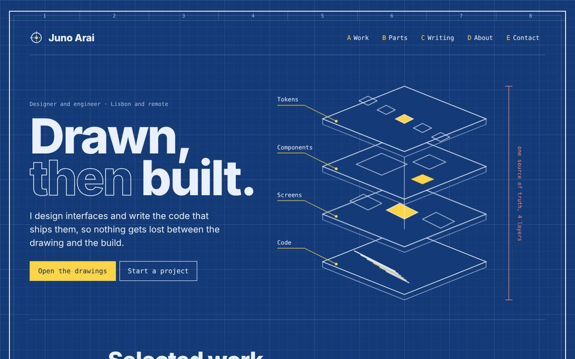

- **Idea:** the portfolio as an engineering drawing set.
- **Look:** a cyanotype sheet with a fine grid, a border frame and zone rulers. The hero is an exploded isometric drawing of the four layers of the work: tokens, components, screens and code. It draws itself on load.
- **Sections:** projects are numbered sheets with orthographic drawings and a title-block strip (material, measure, scale, revision). Skills form a parts list, writing is a revision log, and contact is the drawing's title block with a live cursor readout.
- **Palette:** Prussian blue `#143a78`, chalk `#e9f0ff`, pencil yellow `#ffd447`, redline `#ff8a73`.
- **Type:** Archivo at expanded widths, with Sometype Mono.
- **Strongest:** instantly says "designs and builds". Every section has a natural engineering metaphor.
- **Weakest:** a dark blue page is heavy for long reading. Each project needs a line drawing.

### Specimen (`themes/specimen`)
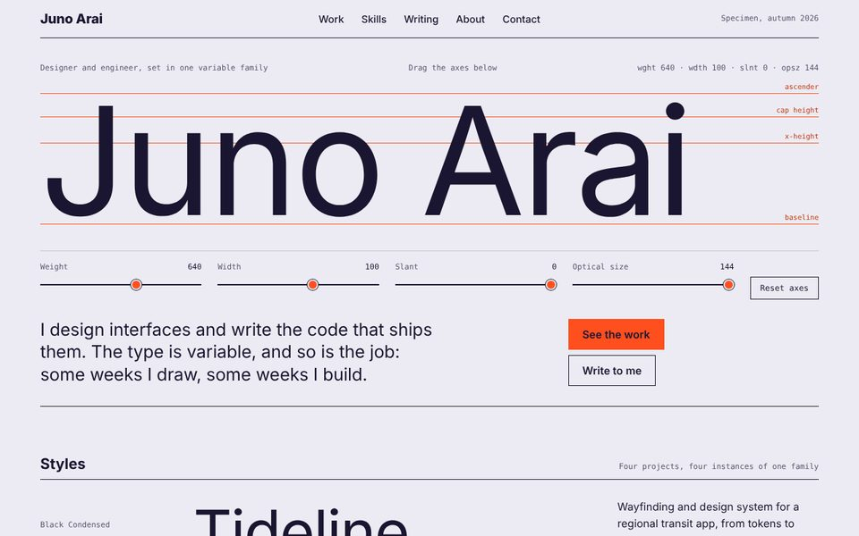

- **Idea:** the portfolio as a type specimen, set entirely in one variable family.
- **Hero:** the name, with metric lines (ascender, cap height, x-height, baseline) and four sliders for weight, width, slant and optical size. It morphs once on load.
- **Sections:**
  - Projects are "styles": each title is set in a different instance and grows heavier on hover.
  - Skills are a character set with a glyph inspector.
  - Writing is a waterfall, newest set largest.
  - About is a justified colophon with a drop cap.
  - Contact is a giant editable line of type that becomes the email body.
- **Palette:** lilac-grey paper `#ecebf3`, aubergine ink `#1a1530`, signal orange `#ff4f1f`.
- **Type:** Roboto Flex with Martian Mono.
- **Strongest:** the most refined and the cheapest to maintain, since everything is type.
- **Weakest:** it depends on Roboto Flex loading. Without the web font the axes do nothing.

### Riso (`themes/riso`)
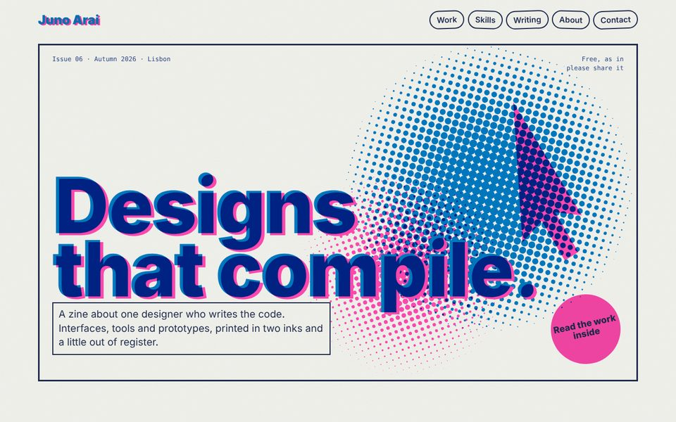

- **Idea:** the portfolio as a two-ink risograph zine.
- **Look:**
  - Fluorescent pink and blue overprint with multiply blending, halftone illustrations and paper grain.
  - The cover headline is printed twice, slightly out of register, and the pink plate drifts with the cursor.
  - Projects are taped-in, tilted prints.
- **Sections:** skills are a sticker sheet you can "peel" to read what each means in practice. Writing is the table of contents and about is a letter. Contact is a notice-board flyer with tear-off tabs.
- **Palette:** paper `#f1f1ec`, fluorescent pink `#ff48b0`, riso blue `#0078bf`, federal blue `#2e4a85` for text.
- **Type:** Anybody with Azeret Mono.
- **Strongest:** warm, memorable and clearly made by a person. Good for a designer who prints or makes things.
- **Weakest:** the tilts and blending cost some polish and scannability. Pink is never used for text, for contrast.

### Workbench (`themes/workbench`)
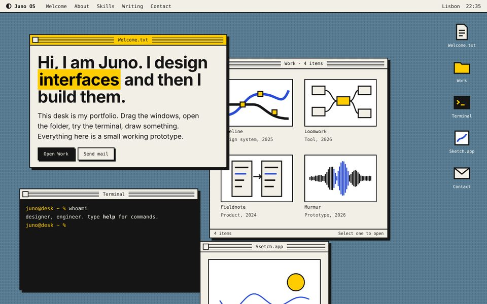

- **Idea:** the portfolio as a one-bit desktop.
- **Desktop:** a dithered desktop, a menu bar with a live clock, desktop icons, and windows with hard shadows. You can:
  - drag the windows by their title bars;
  - open the Work folder to read a project;
  - type `help`, `work`, `skills` or `contact` into a working terminal;
  - draw in a small sketch app.
- **Below the desktop:** an "About this designer" panel, an installed-skills table and a documents list.
- **Palette:** slate desktop `#5b7f95`, window `#f2efe6`, black, selection blue `#2a4bd7`, title-bar yellow `#ffcc00`.
- **Type:** Silkscreen for chrome, Atkinson Hyperlegible for reading, Fragment Mono for the terminal.
- **Strongest:** the most playful. It shows interface craft directly, and the windows are real working prototypes.
- **Weakest:** a novelty if overused. On phones the windows stack into a plain column.

### Playground (`themes/playground`)
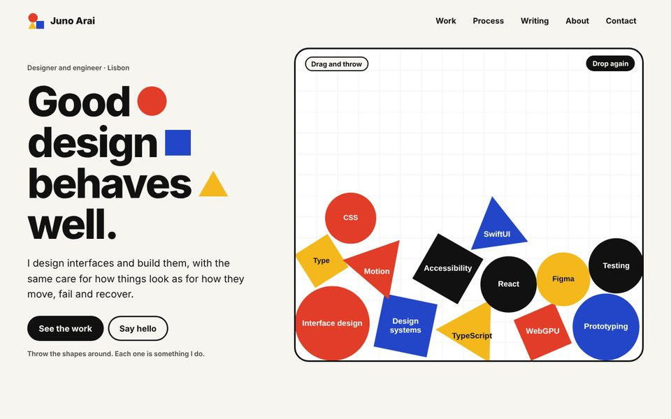

- **Idea:** the portfolio as a Bauhaus toy.
- **Hero:** a small physics simulation in which every skill is a circle, square or triangle that falls, stacks, and can be grabbed and thrown. "Drop again" resets it.
- **Sections:** each project has a primary-colour geometric composition that rearranges on hover. The process is a real four-step sequence, writing rows carry rotating shape markers, and the footer CTA is a giant yellow disc.
- **Palette:** paper `#f6f5f0`, red `#e23d28`, blue `#2346c9`, yellow `#f4b81c`, black.
- **Type:** Unbounded with Manrope.
- **Strongest:** joyful and tactile. It proves motion and interaction skill in the first second.
- **Weakest:** the primaries and geometry say "design" more than "engineering". The physics needs care on low-power phones.

### Instrument (`themes/instrument`)
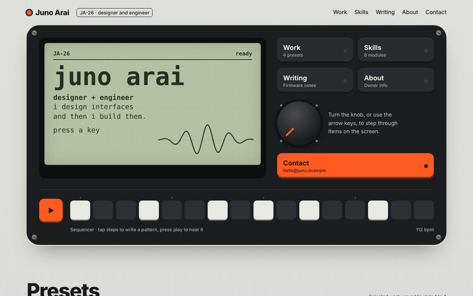

- **Idea:** the portfolio as a piece of hardware, like a synthesiser faceplate.
- **Device:** a dark device on brushed aluminium with screws, a backlit LCD, and four program keys (Work, Skills, Writing, About) that switch the screen. A rotary knob steps through items by drag, scroll wheel or arrow keys. A 16-step sequencer plays the pattern you write with Web Audio.
- **Sections:** below the device the page becomes the manual: presets for projects, specifications for skills, firmware notes for writing, owner information for about, and support for contact.
- **Palette:** aluminium `#d6d7d2`, graphite `#1c1d1f`, signal orange `#ff5a1f`, LCD `#b9c4a6` with LCD ink `#26301f`.
- **Type:** Schibsted Grotesk with Doto (dot matrix) on the screen.
- **Strongest:** the strongest product-design statement. It reads as industrial design, interface design and engineering at once.
- **Weakest:** the device takes the whole first screen. Visitors who skip it need the manual below.

### Which to pick
- **Instrument or Blueprint** if the audience hires for product design and engineering together: hardware, tools and design systems.
- **Specimen** if typography and restraint are the brand.
- **Riso or Playground** if the work is expressive and the audience is creative studios.
- **Workbench** as a side project or "about me" page rather than a main portfolio.

## Animation-inspired themes

Eight directions that borrow techniques from animation and print, two for each audience:

| Audience | Placeholder person |
| --- | --- |
| Technology | Ren Okafor, platform engineer; Tomo Vega, game engineer |
| Blogger | Mika Sol, *Slow Pixels*; Theo Marsh, *The Long Reel* |
| Designer | Juno Arai; Lio Park |
| Researcher | Amara Lind, biophysicist; Sami Haddad, mathematician |

Every mascot, character and illustration is original and drawn in code. Nothing is copied from an existing film, game or comic.

### Technology

#### Miniature City (`themes/miniature-city`)
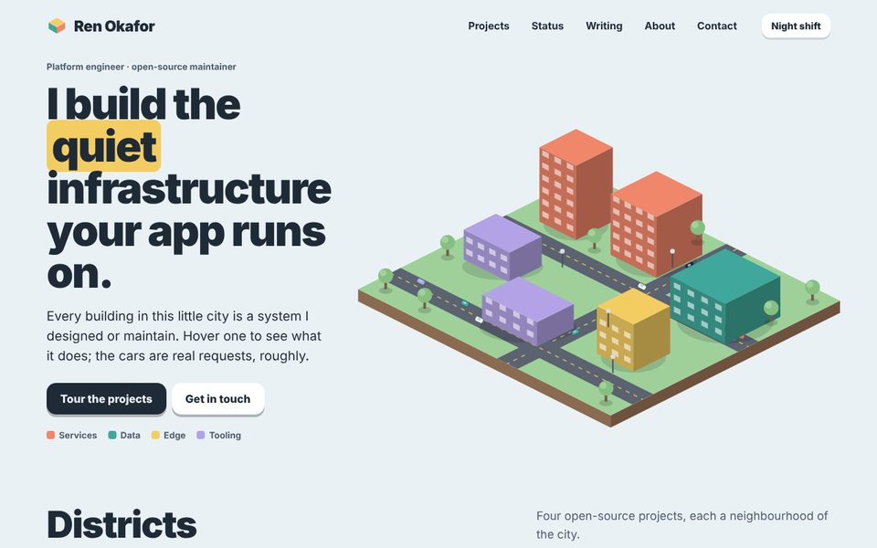

- **Borrows:** tilt-shift miniatures and isometric city builders.
- **Hero:** each building in an isometric diorama is a service. Hovering explains it, and little cars (requests) drive the roads.
- **Interaction:**
  - A night-shift toggle lights the windows and street lamps.
  - Projects are "districts".
  - System status is a departures board whose statuses flip like split-flap letters.
- **Palette:** pastel coral, teal, butter and lavender on pale sky.
- **Type:** Gabarito and Nunito Sans.
- **Best for:** infrastructure, platform and backend engineers. It makes invisible work visible and friendly.
- **Watch:** the diorama is hand-placed. Adding services means placing new buildings.

#### Pixel Quest (`themes/pixel-quest`)
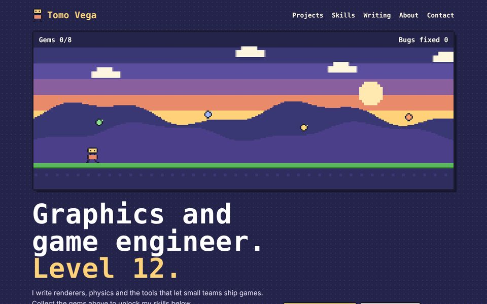

- **Borrows:** 8-bit platformers.
- **Hero:** a playable runner with an original robot sprite. Space, click or tap jumps. Collecting gems unlocks the matching skills in the inventory below, and landing on bugs "fixes" them.
- **Sections:** projects are a quest log with XP bars, writing is save files, and contact is a "Continue?" countdown.
- **Palette:** dusk bands of navy, plum, peach and sun on a dotted night grid.
- **Type:** Pixelify Sans with Rethink Sans for reading.
- **Best for:** game, graphics and creative-coding engineers.
- **Watch:** the game is a delight but not essential. Everything is also readable without playing.

### Blogger

#### Manga Panels (`themes/manga-panels`)
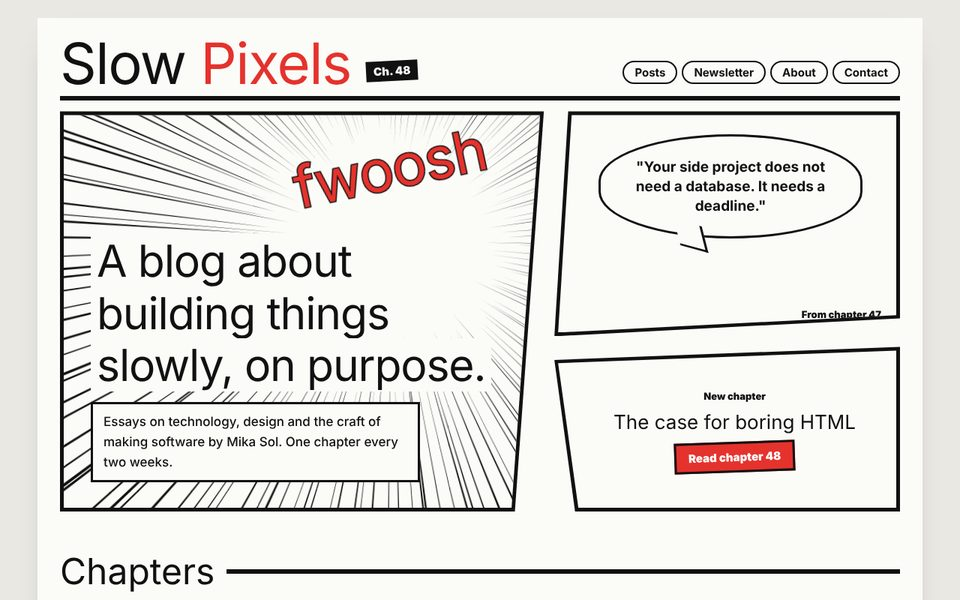

- **Borrows:** manga page layout. The page is a comic page with slanted panel gutters, screentone dots and red sound-effect lettering.
- **Hero:** jittering radial speed lines.
- **Sections:**
  - Posts are panels of different sizes; hovering flips one into an inverted "impact frame".
  - Category chips filter the posts.
  - The newsletter sign-up sits in a speech balloon.
  - About is a four-panel strip.
- **Palette:** black, paper and one spot red.
- **Type:** Dela Gothic One and Zen Kaku Gothic New.
- **Best for:** opinionated personal blogs and essay newsletters.
- **Watch:** the panel grid needs a featured post with an illustration to feel full.

#### Old Reel (`themes/old-reel`)
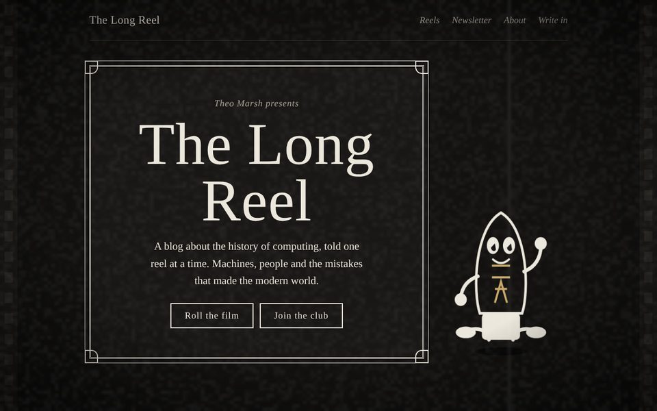

- **Borrows:** 1930s rubber-hose cartoons and silent-film title cards.
- **Opening:** a 3-2-1 film leader, which can be skipped.
- **Look:** live film grain and scratches, flicker, a vignette and sprocket strips. The intertitle has ornate corners, and an original vacuum-tube mascot bounces with squash and stretch.
- **Interaction:** sections open with an iris wipe as you scroll. Hovering a "reel" irises in its excerpt from the cursor position. The page ends on "The End".
- **Palette:** film black, silver and one sepia accent.
- **Type:** Limelight and Old Standard TT.
- **Best for:** history, culture and long-form storytelling blogs.
- **Watch:** keep the grain subtle for long reading; the leader runs once per visit.

### Designer

#### Clay Studio (`themes/clay-studio`)
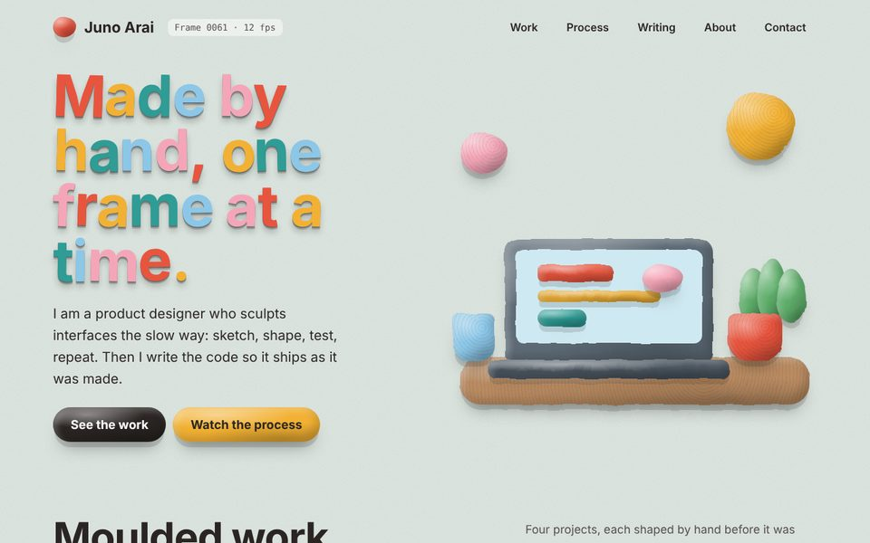

- **Borrows:** claymation and stop-motion.
- **Animation:** every idle movement runs at 6 to 12 frames per second, like stop-motion. Clay letters jitter, blobs "boil", an SVG wobble filter changes seed each frame, and a frame counter ticks in the header.
- **Look:** shapes are plasticine, with soft highlights, fingerprint texture and squash on press.
- **Process:** a six-frame stop-motion with onion skinning. Scrub it, click frames or press play.
- **Palette:** tomato, mustard, teal, sky and pink on mint felt.
- **Type:** Fredoka and Rubik.
- **Best for:** product and brand designers with a tactile, playful style.
- **Watch:** the hero scene is the signature. Real projects should get their own clay illustrations.

#### Pop-up Book (`themes/pop-up-book`)
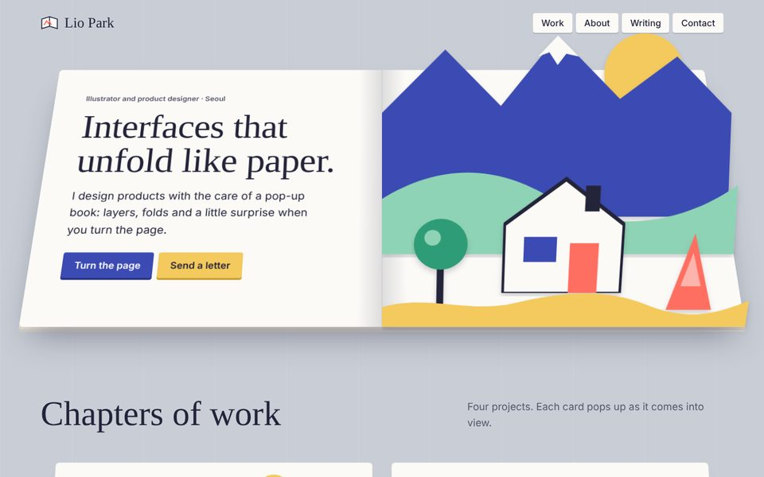

- **Borrows:** paper engineering.
- **Hero:** an open book whose right page pops up a layered paper scene (mountains, sun, hills, house, tree) that rises on load. The spread tilts with the pointer.
- **Sections:** project cards pop up their figures as they scroll into view. About has a working pull tab, writing is ribbon bookmarks, and contact is an envelope that opens to reveal the letter.
- **Palette:** paper white on a slate desk with indigo, coral, mint and mustard.
- **Type:** Young Serif and Work Sans.
- **Best for:** illustrators and product designers, especially in education and publishing.
- **Watch:** 3D transforms are kept shallow, and on phones the book flattens into a single page.

### Researcher

#### Powers of Ten (`themes/powers-of-ten`)
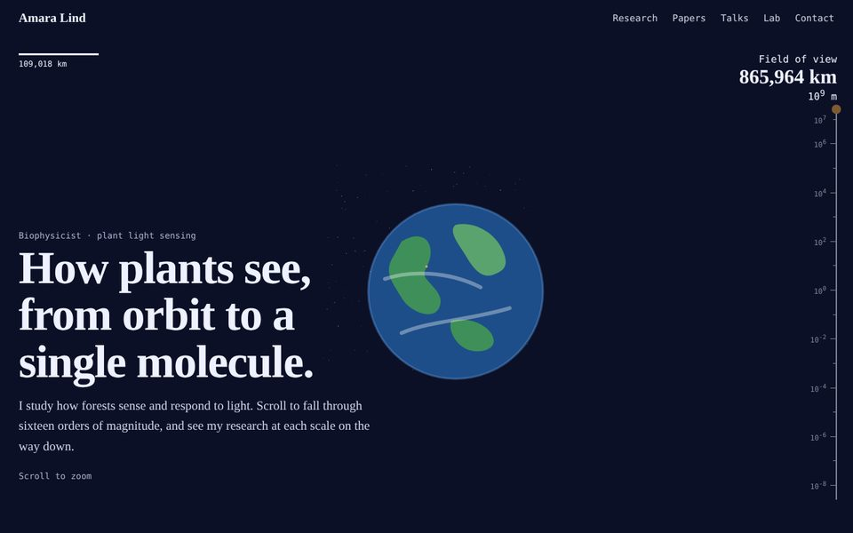

- **Borrows:** the classic continuous-zoom film idea.
- **Hero:** scrolling falls through sixteen orders of magnitude in one sticky stage: planet, forest canopy, leaf, plant cell, one photoreceptor protein. Each scene zooms continuously into the next.
- **Readouts:**
  - a field-of-view number and an exponent ruler;
  - a caption with the research and paper at that scale;
  - a background colour that shifts from space to the lab.
- **Sections:** papers can be filtered by scale.
- **Palette:** shifts with scale, with amber and violet accents.
- **Type:** Literata and Red Hat Mono.
- **Best for:** researchers whose work spans scales (ecology, biology, physics, climate).
- **Watch:** the zoom is long (about eight screens). Consider a "skip to papers" link for returning visitors.

#### Chalk Lecture (`themes/chalk-lecture`)
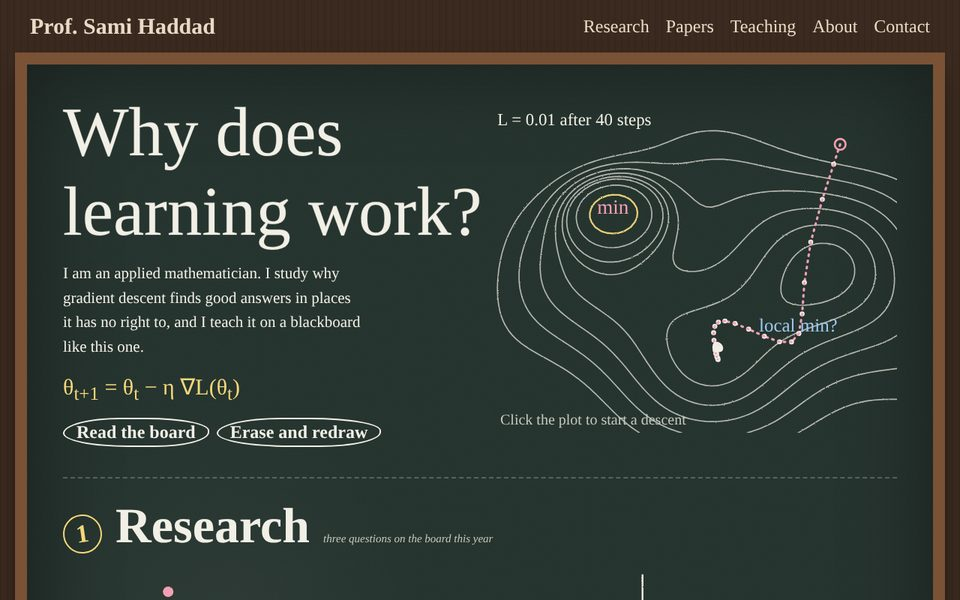

- **Borrows:** blackboard lectures and hand-drawn explainer animation.
- **Look:** a framed chalkboard with dust, smudges and a chalk tray. The title writes itself stroke by stroke, and the update rule is chalked in yellow.
- **Hero interaction:**
  - Contour lines draw on.
  - Clicking anywhere on the loss surface runs a gradient descent with momentum and leaves a dotted chalk trail.
  - "Erase and redraw" sweeps a felt eraser across the board and starts again.
- **Sections:** research threads draw their chalk diagrams on scroll, papers are a numbered reading list, and teaching is a timetable.
- **Palette:** slate green with white, yellow, pink and blue chalk, framed in wood.
- **Type:** Caveat and Crimson Pro.
- **Best for:** academics and teachers in mathematics, machine learning, physics and economics.
- **Watch:** handwriting fonts are for headings only. Body text stays in a readable serif.

### Picking one
- **Technology:** Miniature City for infrastructure work, Pixel Quest for graphics and games.
- **Bloggers:** Manga Panels for punchy essays, Old Reel for history and storytelling.
- **Designers:** Clay Studio for tactile, playful work, Pop-up Book for illustration-led product design.
- **Researchers:** Powers of Ten when the work spans scales, Chalk Lecture when teaching is part of the identity.

## Architecture-inspired themes

Eight directions for an architect-designer. Each borrows the materials, geometry and spatial ideas of one building tradition.

All eight use the same placeholder practice, Oduya Architects (Nia Oduya), and the same projects (Tidewater Library, Cork House, Quay Market Hall, Vale Chapel). That keeps the comparison fair: only the design changes. All drawings are original and generated in code.

### Béton (`themes/beton`) · Brutalism
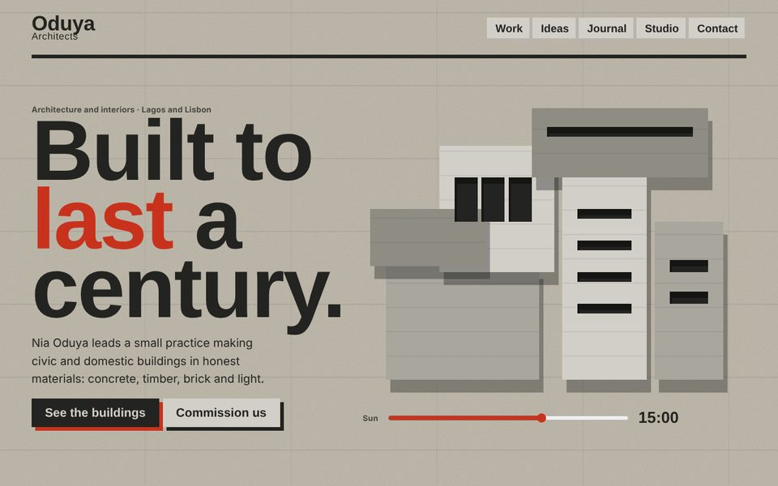
- **Look:** board-marked concrete texture and a cantilevered massing.
- **Interaction:** a "Sun" slider sets the time of day. The blocks' shadows swing and lengthen, and the page warms toward evening.
- **Sections:** projects sit in deep concrete coffers with plan drawings and material facts. Three numbered rules sit on pillars, and contact is a dark "pour" band.
- **Palette:** concrete greys with one signal red.
- **Type:** Big Shoulders Display and Karla.
- **Best for:** civic and material-led practices.

### Deco Tower (`themes/deco-tower`) · Art Deco
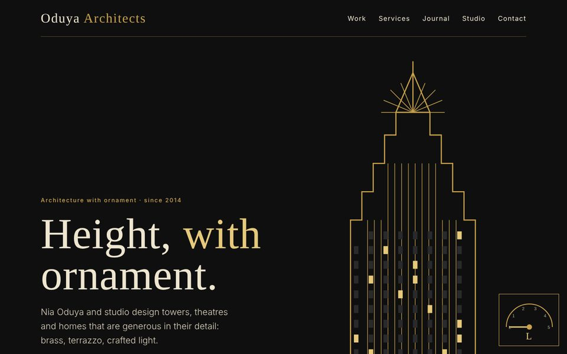
- **Look:** a gold-line tower elevation draws itself, with windows lighting up at random.
- **Interaction:** a brass elevator dial follows your scroll position floor by floor and opens into a floor list.
- **Sections:** projects are stepped-corner frames with sunburst headers and a gold shimmer on hover. Services are a lobby directory board, and contact is "the lobby".
- **Palette:** black lacquer, gold, cream and jewel tones.
- **Type:** Poiret One and Jost.
- **Best for:** hospitality, restoration and towers.

### Shoji (`themes/shoji`) · Japanese minimalism
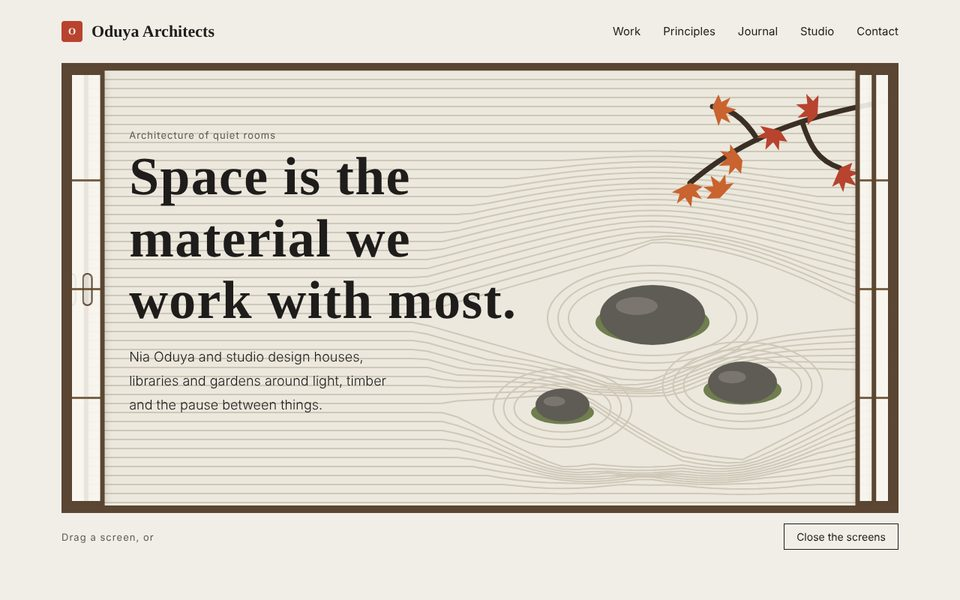
- **Look:** four paper screens with kumiko lattice slide open on load to reveal a raked gravel garden. You can drag each screen.
- **Sections:**
  - Projects are laid out as a tatami-mat floor plan.
  - Section names run vertically.
  - Principles are ma, light and timber.
  - About carries a hanko seal.
  - Contact is a noren curtain that parts on hover.
- **Palette:** washi, timber, sumi ink, moss and seal red.
- **Type:** Shippori Mincho and M PLUS 1.
- **Best for:** residential, landscape and craft-focused studios.

### Rose Window (`themes/rose-window`) · Gothic
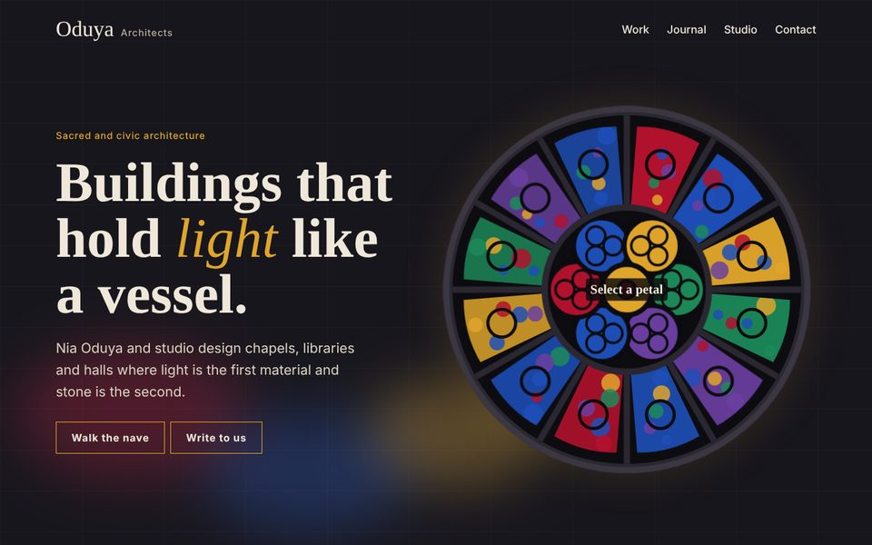
- **Look:** a stained-glass rose window whose petals are links that glow and name their destination.
- **Sections:** projects are four lancet windows of procedurally leaded glass. Coloured light pools drift as you scroll, and the journal is a "book of hours" with illuminated initials.
- **Palette:** nave stone with ruby, cobalt, gold, emerald and violet glass.
- **Type:** Cormorant Garamond and Alegreya Sans, with a blackletter wordmark.
- **Best for:** sacred buildings, conservation and lighting-led practices.

### Glass Pavilion (`themes/glass-pavilion`) · Mid-century modern
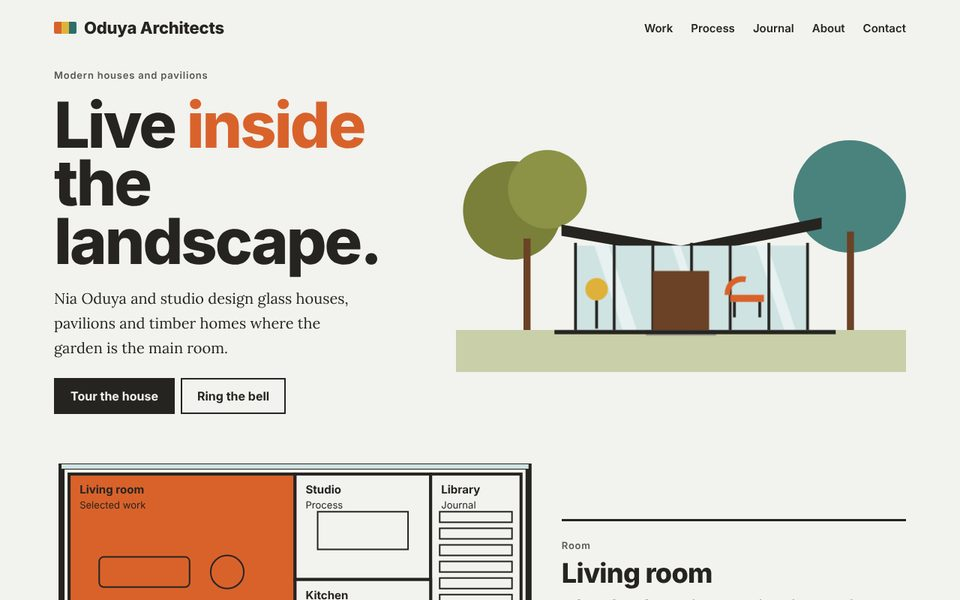
- **Look:** a butterfly-roof glass house elevation.
- **Interaction:**
  - A floor plan is the main navigation: hover or tab to a room to preview its section, then click to go there.
  - The living room holds the work, the studio the process, the library the journal, the kitchen the about section, and the entry the contact.
  - The doorbell rings (two chimes) and reveals the email.
- **Palette:** walnut, olive, burnt orange, mustard and teal.
- **Type:** League Spartan and Lora.
- **Best for:** residential architects.

### Zellige (`themes/zellige`) · Islamic geometry
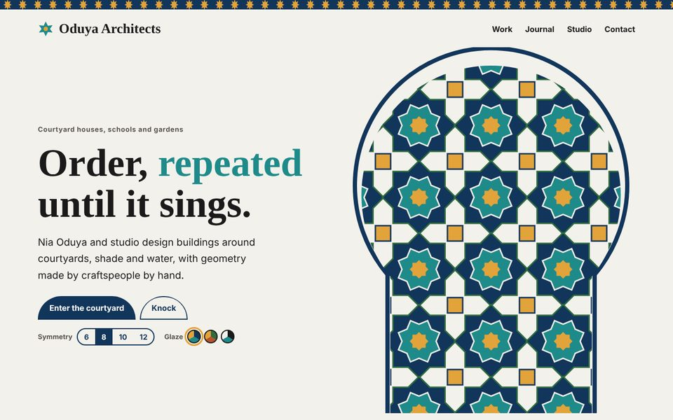
- **Look:** a generative star-tile pattern inside a horseshoe (keyhole) arch.
- **Interaction:** switch the symmetry (6, 8, 10 or 12-fold) and the glaze palette.
- **Sections:** projects sit in a quartered courtyard garden around a fountain, the journal is an arcade of arches, and contact is a great patterned arch.
- **Palette:** plaster, deep blue, turquoise, emerald, terracotta and saffron.
- **Type:** Amiri and Mulish.
- **Best for:** courtyard, school and climate-responsive design.

### Brise-soleil (`themes/brise-soleil`) · Tropical modernism
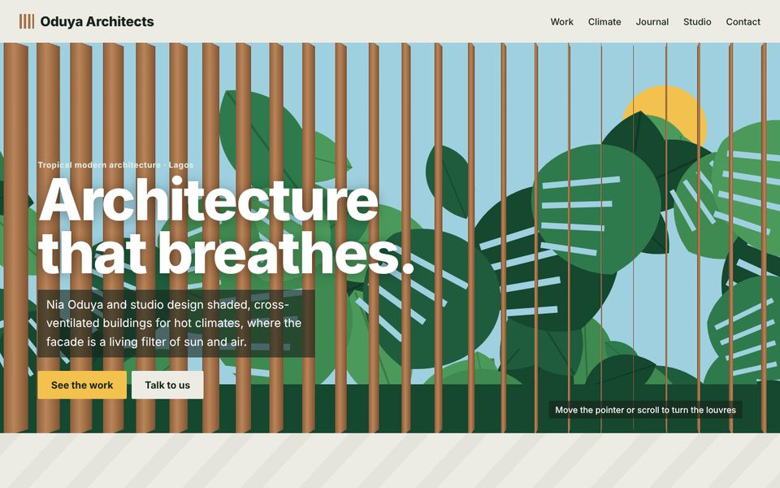
- **Look:** a facade of timber louvres that close and reopen on load, then turn with the pointer or scroll to reveal a jungle garden behind.
- **Sections:**
  - Louvre shadows fall across the content.
  - A vine grows down the page as you scroll.
  - Each project is shown through its breeze-block screen.
  - A passive-cooling strip has drifting wind marks.
- **Palette:** concrete, tropical greens, timber and sun yellow.
- **Type:** Syne and DM Sans.
- **Best for:** hot-climate and sustainable practices.

### Fracture (`themes/fracture`) · Deconstructivism
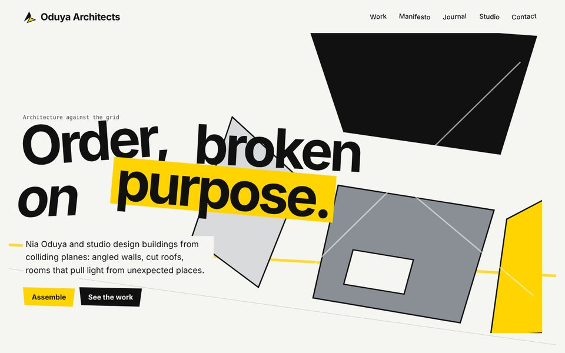
- **Look:** shattered planes assemble, then break apart and drift with the pointer. An "Assemble" toggle puts them back together.
- **Sections:** the headline words come unstuck and "lines of force" cross the page. Project cards are tilted and clipped and straighten on hover. Contact is a sliced headline that rejoins on hover.
- **Palette:** white, black, steel grey and safety yellow.
- **Type:** Familjen Grotesk and Chivo Mono.
- **Best for:** experimental and competition-led practices.

### Picking one
- **Show material and permanence:** Béton.
- **Show craft and calm:** Shoji.
- **Show homes:** Glass Pavilion.
- **Show climate thinking:** Brise-soleil or Zellige.
- **Make a statement:** Fracture or Deco Tower.

## Software and AI developer themes

Eight directions for a software and AI engineer. Each borrows the look and the interaction model of a tool developers use every day, so the page itself shows the person knows the craft.

All eight use the same placeholder engineer, Ezra Lin, and the same projects (Relay, an LLM gateway; Sieve, an eval harness; Atlas, a search engine; Patchwork, a code-review agent). Only the design changes.

### Circuit Board (`themes/circuit-board`) · PCB
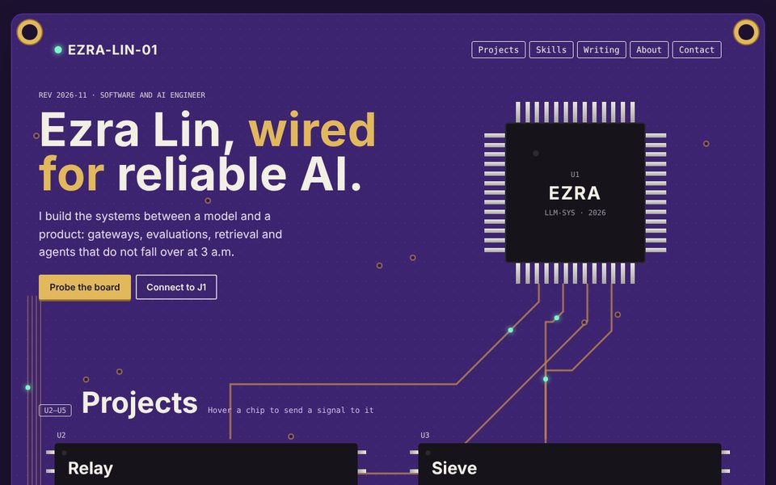
- **Look:** purple solder mask, copper traces, gold mounting holes and white silkscreen labels. The hero is a QFP chip with Ezra's name on it.
- **Interaction:** green signals travel along traces from the CPU to each project chip; hovering a chip lights its trace and speeds up its signal. Three DIP switches power up the contact line.
- **Sections:** projects are ICs (U2 to U5), skills are a bill of materials of SMD parts, writing is a row of test points, and about is a revision block.
- **Type:** Chakra Petch and Share Tech Mono.
- **Best for:** embedded, infra and hardware-adjacent engineers.

### TUI (`themes/tui`) · terminal UI
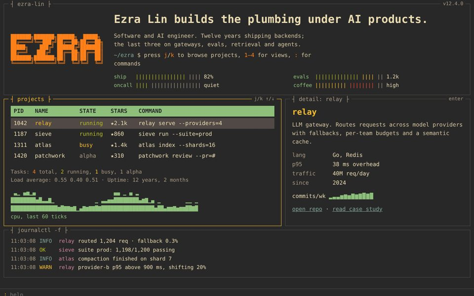
- **Look:** a full-screen terminal app in the Gruvbox dark palette, with box-drawn panes, an ASCII logo and an htop-style process list.
- **Interaction:** `j`/`k` move through projects, `1`–`4` switch views, `:` opens a command line (`help`, `open atlas`, `mail`, and a joke for `:q`). A log tails itself and a CPU graph ticks.
- **Type:** JetBrains Mono only.
- **Caveat:** keyboard-first by design; every action also works by click.
- **Best for:** backend and tooling engineers.

### Attention (`themes/attention`) · transformer internals
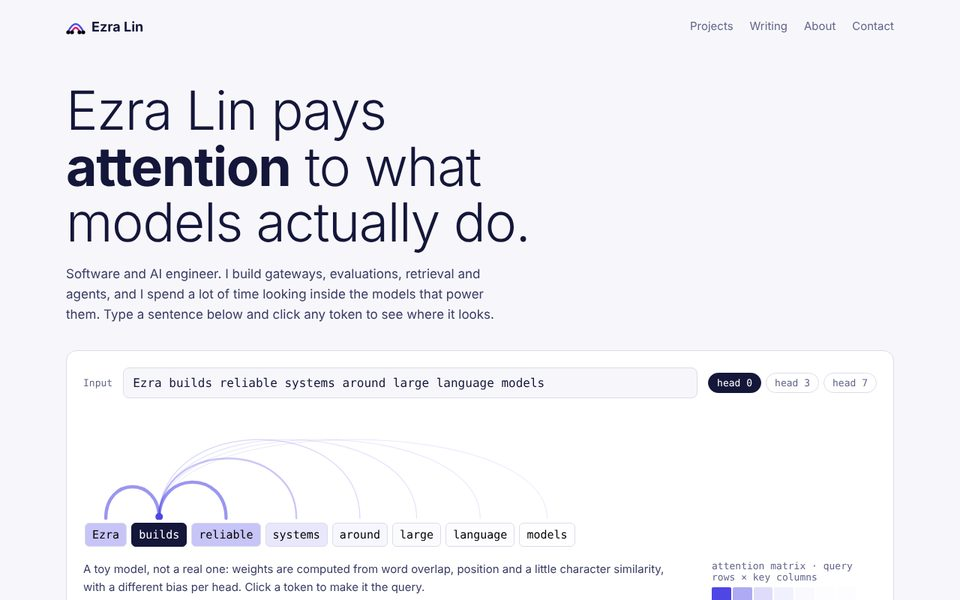
- **Look:** a light, precise lab page in indigo, magenta and teal.
- **Interaction:** type any sentence, click a token, and see attention arcs and a full attention matrix. Three "heads" use different toy rules (neighbours, shared letters, look-back). The page says plainly that it is a toy, not a real model.
- **Sections:** sections are layers; each project block shows the topics it "attends to"; contact is an output distribution with "you" as the next token.
- **Type:** Sora and Fira Code.
- **Best for:** ML engineers and researchers.

### Git Graph (`themes/git-graph`) · version control
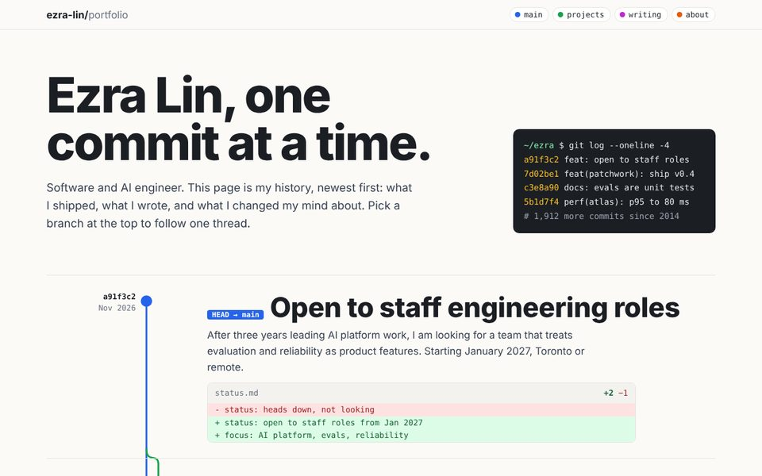
- **Look:** a warm-white commit log with coloured branch lanes, hashes, refs, tags and real-looking diffs.
- **Interaction:** branch pills (main, projects, writing, about) highlight one lane and dim the rest. Contact is an uncommitted change; its button "commits" and opens mail.
- **Type:** Onest and Victor Mono.
- **Best for:** engineers whose career reads well as a timeline.

### Node Graph (`themes/node-graph`) · visual pipeline editor
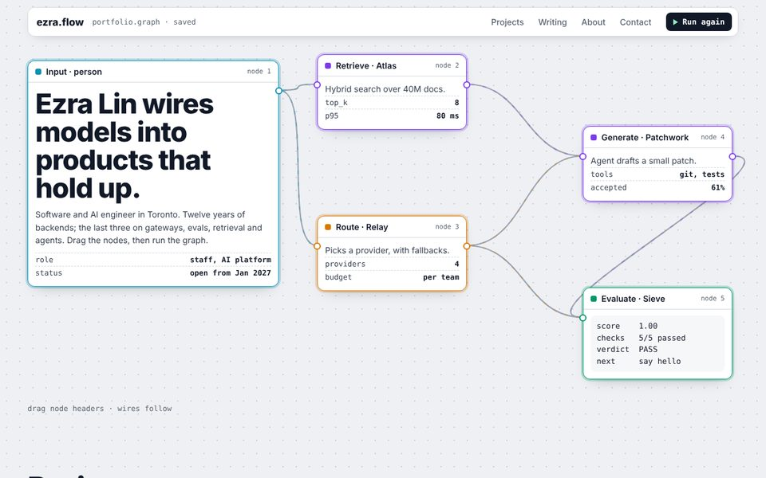
- **Look:** a dotted canvas with node cards and bezier wires, like ComfyUI or a workflow builder.
- **Interaction:** drag nodes by their headers and the wires follow. "Run graph" lights each node in order, animates data along the wires and prints a result in the Evaluate node.
- **Sections:** project cards each carry a mini graph; writing items are tagged by node type.
- **Type:** Inter Tight and Space Mono.
- **Caveat:** on phones the canvas becomes a simple stack of nodes.
- **Best for:** AI app and agent builders.

### Notebook (`themes/notebook`) · Jupyter
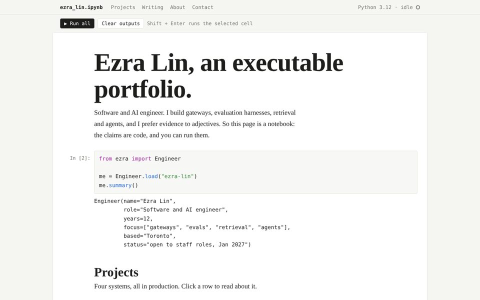
- **Look:** markdown and code cells with `In [n]:` prompts, syntax colours and a kernel indicator.
- **Interaction:** "Run all" executes the cells in order. Outputs include a printed bio, a projects dataframe (click a row), a bar chart and a deprecation warning for `hype_level()`. Shift + Enter runs one cell.
- **Type:** Source Serif 4 and Source Code Pro.
- **Best for:** data scientists and ML engineers.

### Chat (`themes/chat-model`) · LLM chat interface
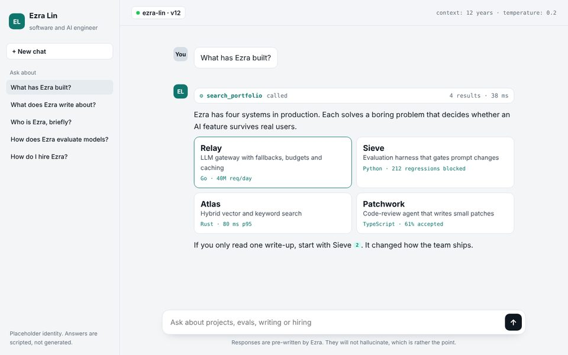
- **Look:** a familiar chat layout in soft grey and teal, with a sidebar of questions.
- **Interaction:** suggested prompts or free text get streamed, scripted answers with collapsible tool calls, project cards and citations. A simple keyword router picks the answer; nothing is generated.
- **Type:** Instrument Sans and Recursive (mono axis).
- **Best for:** AI product engineers.

### Spreadsheet (`themes/spreadsheet`) · Excel or Sheets
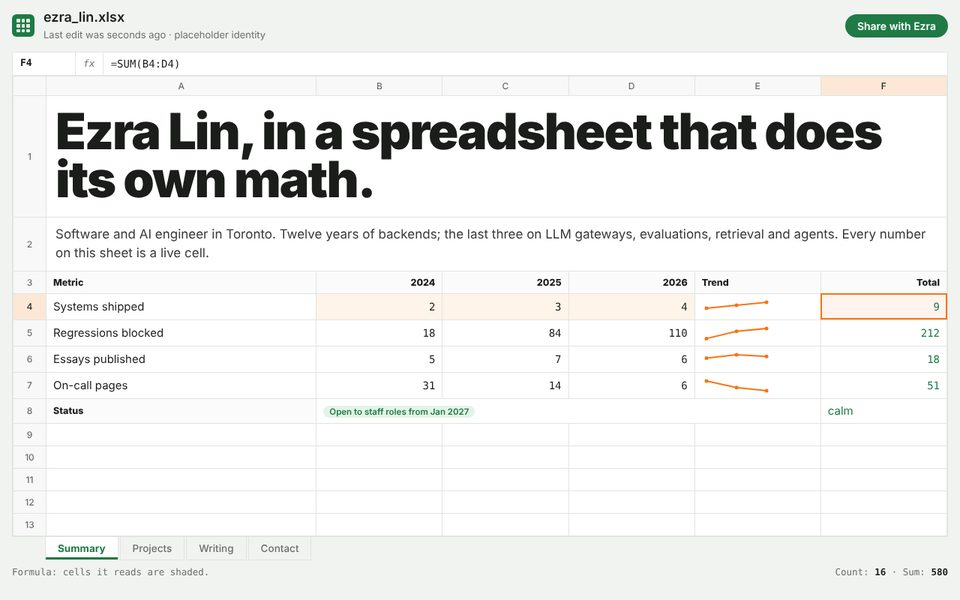
- **Look:** a spreadsheet with row and column headers, a formula bar, sheet tabs and a status bar.
- **Interaction:** cells hold real formulas (`SUM`, `IF`, ratios). Select a formula to shade the cells it reads; edit a number in the formula bar and dependent totals, shares and bars recalculate. Arrow keys move the selection.
- **Type:** Libre Franklin and Overpass Mono.
- **Caveat:** on phones the sheet scrolls sideways, as a real one would.
- **Best for:** data, analytics and fintech engineers.

## openloop design system (`existing/`)

Twelve earlier directions, exported unchanged from the openloop Design System artifact. Each page links `existing/tokens.css`, which is generated from `openloop-design-system/tokens.json`, and sets its theme with `data-theme` on `<html>`.

| Folder | Direction | Theme |
| --- | --- | --- |
| `editorial-minimal` | Editorial Minimal | `editorial` |
| `ai-research-lab` | AI Research Lab | `lab` |
| `bento-product` | Bento Product | `bento` |
| `bento-systems` | Bento Systems | `bento` |
| `intelligent-editorial` | Intelligent Editorial | `intelligent` |
| `vectorlab-handbook` | Vectorlab Handbook | `vectorlab` |
| `vectorlab-journal` | Vectorlab Digital Science Journal | `journal` |
| `swiss-journal` | Swiss Scientific Journal | palette inside the page |
| `research-observatory` | Modern Research Observatory | palette inside the page |
| `field-journal` | Technical Field Journal | palette inside the page |
| `design-magazine` | Computational Design Magazine | palette inside the page |
| `knowledge-platform` | Premium Knowledge Platform | palette inside the page |

`openloop-design-system/README.md` is the brand book, and `exploration-2.md` compares the five Vectorlab concepts.

## Notes
- **Fonts:** all fonts load from Google Fonts. Offline, pages fall back to system fonts and the Specimen axes stop working.
- **Accessibility:** every page is responsive down to 390px wide and respects `prefers-reduced-motion`. Every interactive element is keyboard reachable with a visible focus ring.
- **Content:** all names, projects, metrics and contact addresses are placeholders.
